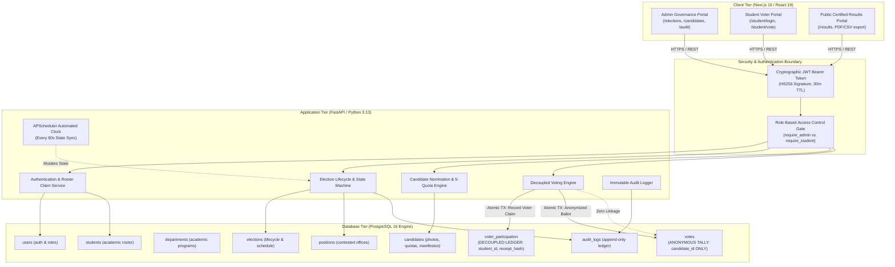
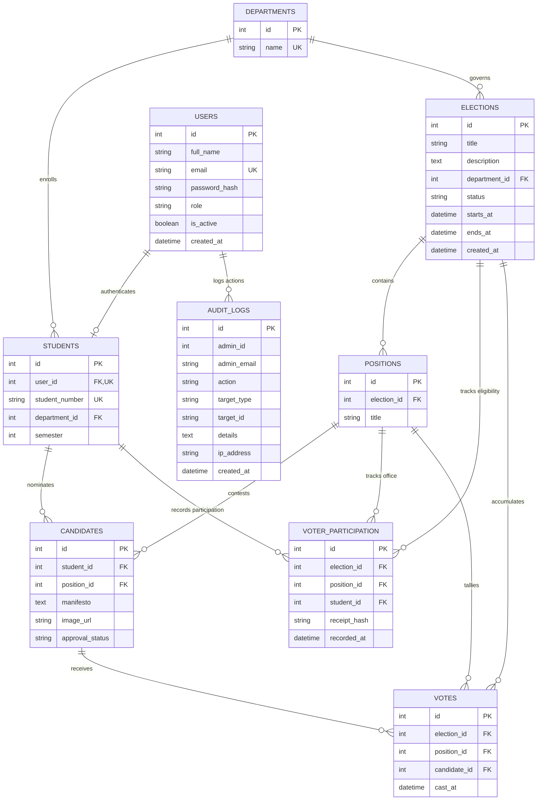
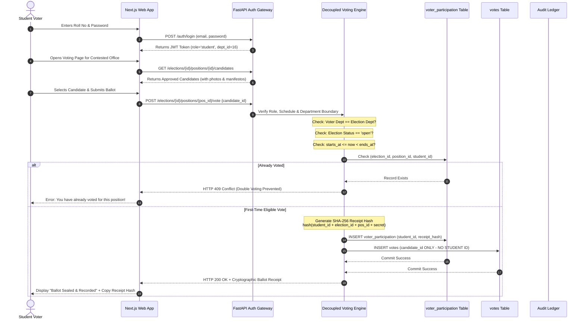
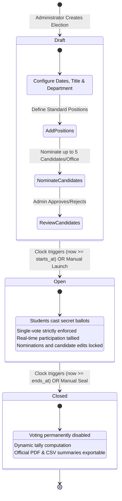

# SMARTVOTE: Decoupled Cryptographic Campus Electronic Voting & Governance System
## Comprehensive Project Documentation & Viva Voce Dossier

---

### **Executive Summary & Metadata**
- **Project Title:** SmartVote - Decoupled Cryptographic Campus Electronic Voting & Governance System
- **Academic Discipline:** Master of Computer Applications (MCA) / Postgraduate Computer Science
- **Architectural Paradigm:** 3-Tier Distributed Architecture with Decoupled Secret Ballot Ledger
- **Primary Technologies:** FastAPI (Python), Next.js (TypeScript/React), PostgreSQL (ACID RDBMS), Docker, APScheduler
- **Key Innovation:** Complete mathematical decoupling of voter identity from cast ballots with SHA-256 cryptographic voter receipts, strict departmental boundary enforcement, and immutable administrative audit trails.

---

## TABLE OF CONTENTS
1. [Introduction](#1-introduction)
2. [Problem Statement & Core Objectives](#2-problem-statement--core-objectives)
3. [System Architecture & Data Flow](#3-system-architecture--data-flow)
4. [Functional Modules Specification](#4-functional-modules-specification)
5. [Database Architecture & Data Dictionary](#5-database-architecture--data-dictionary)
6. [Entity-Relationship (ER) Diagram](#6-entity-relationship-er-diagram)
7. [Unified Modeling Language (UML) Diagrams](#7-unified-modeling-language-uml-diagrams)
8. [Technologies & Frameworks Stack](#8-technologies--frameworks-stack)
9. [Cryptographic Privacy & Security Mechanisms](#9-cryptographic-privacy--security-mechanisms)
10. [Automated Testing & Verification Suite](#10-automated-testing--verification-suite)
11. [Deployment & Containerization (Docker)](#11-deployment--containerization-docker)
12. [Future Scope & Research Directions](#12-future-scope--research-directions)
13. [Conclusion](#13-conclusion)
14. [Viva Voce Examination Q&A Defense Guide](#14-viva-voce-examination-qa-defense-guide)

---

## 1. Introduction

Democracy in academic institutions serves as the cornerstone for student leadership development, representative governance, and collegiate community engagement. Traditionally, colleges and universities conduct departmental and collegiate student council elections through manual paper balloting or rudimentary electronic polling tools.

### 1.1 Limitations of Traditional Election Systems
1. **Paper Ballots:** Prone to physical tampering, ballot stuffing, manual counting errors, prolonged tabulation delays, and substantial environmental waste.
2. **Conventional Web Polls:** Typical web forms store the voter's identity alongside their selection in a single database record (e.g., `user_id`, `candidate_id`), violating ballot secrecy and exposing voters to administrative surveillance or peer coercion.
3. **Cross-Department Contamination:** In large universities, students from one department (e.g., MBA) inadvertently or maliciously participate in another department's elections (e.g., MCA), undermining departmental self-governance.
4. **Lack of Verifiability:** Voters cannot independently verify whether their ballot was genuinely included in the final tally without revealing how they voted.

### 1.2 The SmartVote Paradigm
**SmartVote** is a production-grade, cryptographically backed collegiate election and governance platform designed to eliminate the fundamental tension between **voter anonymity** and **election verifiability**. Utilizing a **decoupled relational ledger** in PostgreSQL, SmartVote permanently severs the link between the student who casts a ballot and the candidate choice recorded. Furthermore, it issues an immutable SHA-256 cryptographic ballot receipt to every student, enforces role-based access control (RBAC), departmental isolation, candidate position quotas, and an immutable administrative audit ledger.

---

## 2. Problem Statement & Core Objectives

### 2.1 The Fundamental Paradox of Electronic Voting
An electronic voting system must satisfy four mutually competing requirements:
- **Anonymity (Secret Ballot):** No entity—including system administrators, database operators, or peers—must be able to determine which candidate a specific student voted for.
- **Integrity (One-Person, One-Vote):** No voter may vote more than once for any given contested position, and no unauthorized or cross-department account may participate.
- **Individual Verifiability:** Every student voter must receive cryptographic proof that their ballot was legitimately received and sealed into the election ledger.
- **Non-Repudiation & Auditability:** All administrative actions (election creation, candidate approvals, schedule modifications) must be recorded in an immutable ledger for institutional governance.

### 2.2 Project Objectives
1. **Implement Decoupled Secret Ballot Tables:** Store voter participation and anonymized ballot selections in physically distinct tables with zero foreign-key linkage between them.
2. **Issue SHA-256 Cryptographic Voter Receipts:** Provide voters with an immutable, cryptographically generated receipt upon ballot submission.
3. **Enforce Departmental Boundary Isolation:** Restrict candidacy and ballot privileges strictly to enrolled students belonging to the target academic program (e.g., MCA, MBA, MCom, MSW, MSc).
4. **Enforce Position Candidate Quotas:** Restrict contested offices to exactly up to 5 candidates per position, with candidate photos and manifestos.
5. **Automate Election Lifecycle Transitions:** Utilize APScheduler background workers to automatically transition election states (`draft` -> `open` -> `closed`) based on UTC/IST time windows without manual intervention.
6. **Provide Tamper-Evident Audit Logging:** Capture all administrative operations in an append-only audit ledger.
7. **Certified Results Export:** Enable one-click generation and cryptographic sealing of official PDF and CSV election tallies.

---

## 3. System Architecture & Data Flow

SmartVote is engineered as a modern **3-Tier Distributed Architecture**, strictly separating concerns between the client presentation, application governance layer, and transactional database tier.



---

## 4. Functional Modules Specification

SmartVote comprises six core functional modules:

### Module 1: Role-Based Authentication & Academic Roster Module
- **JWT Authentication:** Cryptographically signed JSON Web Tokens using `HS256` algorithm with 30-minute expiration.
- **Dual User Roles:**
  - `admin`: Authorized to configure elections, add positions, review candidates, inspect audit logs, and trigger tallies. Denied ballot-casting privileges.
  - `student`: Authorized to view active elections within their department, inspect candidate profiles, and cast exactly one vote per office. Denied administrative mutation APIs.
- **Roster Claiming Mechanism:** Students register using an institutional student number (e.g., `26MCAA01`). The backend validates enrollment against the pre-seeded department roster before granting active voter status.

### Module 2: Administrative Election Lifecycle & Scheduling Module
- **State Machine:**
  - `draft`: Election creation, position definition, and candidate registration. Voting is strictly prohibited.
  - `open`: Active voting window. Candidacy registration and modifications are permanently locked.
  - `closed`: Voting is concluded. Ballots are sealed. Final tallies and certified PDF/CSV summaries become available.
- **Automated Clock (APScheduler):** A background worker checks the database every 60 seconds against server UTC time. When `starts_at <= now < ends_at`, status transitions automatically from `draft` to `open`. When `now >= ends_at`, it automatically transitions to `closed`.

### Module 3: Candidate Governance & Department Boundary Module
- **Standardized Position Selection:** Positions are configured from institutional standard presets (*President, Vice President, General Secretary, Joint Secretary, Treasurer, Cultural Secretary, Sports Secretary, etc.*) eliminating manual typographical errors.
- **Candidate Visual Identification:** Nominees include profile photos/avatars (via direct file upload or image URLs) and campaign manifestos.
- **Strict Department Boundary Isolation:**
  - Candidates must belong to the election's designated academic program (e.g., MCA candidates cannot run in MBA elections).
  - Voters must belong to the election's designated department. Cross-department voting attempts return `HTTP 403 Forbidden`.
- **5-Candidate Position Quota:** Enforces a hard ceiling of at most 5 candidates per contested position. Additional nomination requests are rejected with `HTTP 400 Bad Request`.

### Module 4: Decoupled Secret Ballot & Voting Engine Module
- **Atomic Two-Phase Commit:** When a student casts a ballot:
  1. **Phase 1 (Participation Check & Lock):** The engine checks `voter_participation` for `(election_id, position_id, student_id)`. If present, rejects with `HTTP 409 Conflict`. Otherwise, inserts a record with a generated SHA-256 receipt hash.
  2. **Phase 2 (Anonymous Vote Storage):** The engine inserts a record into `votes` containing *only* `(election_id, position_id, candidate_id, cast_at)`.
- **Zero Foreign-Key Coupling:** The `votes` table contains NO reference to `student_id` or `user_id`. Even a direct database dump reveals only how many votes each candidate received, never who cast them.

### Module 5: Immutable Administrative Audit Ledger Module
- **Non-Repudiation Guarantee:** Every administrative mutation (`CREATE_ELECTION`, `STATUS_TRANSITION`, `CANDIDATE_REGISTERED`, `CANDIDATE_APPROVED`, `CANDIDATE_REJECTED`) is recorded in `audit_logs`.
- **Captured Metadata:** Includes administrative user ID, email address, action type, target entity ID, IP address, JSON payload details, and server timestamp.
- **Append-Only Policy:** The audit log table prohibits all `UPDATE` and `DELETE` operations.

### Module 6: Certified Results & Export Subsystem
- **Real-Time Tally Calculation:** Aggregates total votes, percentage share, and candidate rankings dynamically using SQL group-by aggregations.
- **Certified PDF Generation:** Built with Python `ReportLab` to produce print-ready, officially formatted summary sheets with institution headers, election metadata, final counts, and certification stamps.
- **Machine-Readable CSV Export:** Generates standardized CSV exports for institutional record-keeping.

---

## 5. Database Architecture & Data Dictionary

The SmartVote relational schema is normalized to **Third Normal Form (3NF)** and implemented on PostgreSQL with strict referential constraints.

### 5.1 Table: `users`
Stores user credentials and security scopes.

| Column | Data Type | Constraints | Description |
| :--- | :--- | :--- | :--- |
| `id` | `INTEGER` | `PRIMARY KEY, AUTO_INCREMENT` | Unique user identifier |
| `full_name` | `VARCHAR(150)` | `NOT NULL` | Legal full name |
| `email` | `VARCHAR(255)` | `NOT NULL, UNIQUE, INDEXED` | Institutional email address |
| `password_hash` | `VARCHAR(255)` | `NOT NULL` | Bcrypt one-way password hash |
| `role` | `VARCHAR(20)` | `NOT NULL, DEFAULT 'student'` | Access role (`admin` or `student`) |
| `is_active` | `BOOLEAN` | `NOT NULL, DEFAULT TRUE` | Account active flag |
| `created_at` | `TIMESTAMP WITH TIME ZONE` | `DEFAULT NOW(), NOT NULL` | Account creation timestamp |

### 5.2 Table: `departments`
Stores academic programs for boundary isolation.

| Column | Data Type | Constraints | Description |
| :--- | :--- | :--- | :--- |
| `id` | `INTEGER` | `PRIMARY KEY, AUTO_INCREMENT` | Unique department identifier |
| `name` | `VARCHAR(100)` | `NOT NULL, UNIQUE` | Academic department name (e.g. MCA, MBA) |

### 5.3 Table: `students`
Stores academic roster records and links student users to departments.

| Column | Data Type | Constraints | Description |
| :--- | :--- | :--- | :--- |
| `id` | `INTEGER` | `PRIMARY KEY, AUTO_INCREMENT` | Unique student record identifier |
| `user_id` | `INTEGER` | `FOREIGN KEY (users.id), CASCADE, UNIQUE` | Associated authentication user account |
| `student_number` | `VARCHAR(50)` | `NOT NULL, UNIQUE, INDEXED` | Institutional roll number (e.g., `26MCAA01`) |
| `department_id` | `INTEGER` | `FOREIGN KEY (departments.id), NOT NULL` | Enrolled academic department |
| `semester` | `INTEGER` | `NOT NULL, DEFAULT 1` | Current academic semester |

### 5.4 Table: `elections`
Stores election configurations, status, and temporal schedules.

| Column | Data Type | Constraints | Description |
| :--- | :--- | :--- | :--- |
| `id` | `INTEGER` | `PRIMARY KEY, AUTO_INCREMENT` | Unique election identifier |
| `title` | `VARCHAR(200)` | `NOT NULL` | Election title |
| `description` | `TEXT` | `NULLABLE` | Institutional purpose and rules |
| `department_id` | `INTEGER` | `FOREIGN KEY (departments.id), NULLABLE` | Associated department (or null for university-wide) |
| `status` | `VARCHAR(20)` | `NOT NULL, DEFAULT 'draft'` | Current status (`draft`, `open`, `closed`) |
| `starts_at` | `TIMESTAMP WITH TIME ZONE` | `NOT NULL` | Balloting start timestamp |
| `ends_at` | `TIMESTAMP WITH TIME ZONE` | `NOT NULL` | Balloting close timestamp |
| `created_at` | `TIMESTAMP WITH TIME ZONE` | `DEFAULT NOW(), NOT NULL` | Creation timestamp |

### 5.5 Table: `positions`
Stores contested offices within an election.

| Column | Data Type | Constraints | Description |
| :--- | :--- | :--- | :--- |
| `id` | `INTEGER` | `PRIMARY KEY, AUTO_INCREMENT` | Unique position identifier |
| `election_id` | `INTEGER` | `FOREIGN KEY (elections.id), CASCADE, NOT NULL` | Parent election |
| `title` | `VARCHAR(100)` | `NOT NULL` | Contested office title (e.g., "President") |
| *Composite Constraint* | `UNIQUE(id, election_id)` | `uq_positions_id_election` | Enforces position-election integrity |

### 5.6 Table: `candidates`
Stores candidate nominations, photos, quotas, and approvals.

| Column | Data Type | Constraints | Description |
| :--- | :--- | :--- | :--- |
| `id` | `INTEGER` | `PRIMARY KEY, AUTO_INCREMENT` | Unique candidate identifier |
| `student_id` | `INTEGER` | `FOREIGN KEY (students.id), NOT NULL` | Nominated student |
| `position_id` | `INTEGER` | `FOREIGN KEY (positions.id), CASCADE, NOT NULL` | Contested position |
| `manifesto` | `TEXT` | `NULLABLE` | Campaign agenda and manifesto |
| `image_url` | `VARCHAR(500)` | `NULLABLE` | Photo / avatar URL for ballot recognition |
| `approval_status` | `VARCHAR(20)` | `NOT NULL, DEFAULT 'pending'` | Approval state (`pending`, `approved`, `rejected`) |
| *Composite Constraint* | `UNIQUE(id, position_id)` | `uq_candidates_id_position` | Prevents candidate multi-registration |

### 5.7 Table: `voter_participation` (Decoupled Eligibility Ledger)
Tracks participation without revealing ballot choices.

| Column | Data Type | Constraints | Description |
| :--- | :--- | :--- | :--- |
| `id` | `INTEGER` | `PRIMARY KEY, AUTO_INCREMENT` | Ledger sequence identifier |
| `election_id` | `INTEGER` | `FOREIGN KEY (elections.id), CASCADE, NOT NULL` | Target election |
| `position_id` | `INTEGER` | `FOREIGN KEY (positions.id), CASCADE, NOT NULL` | Contested position |
| `student_id` | `INTEGER` | `FOREIGN KEY (students.id), CASCADE, NOT NULL` | Participating student |
| `receipt_hash` | `VARCHAR(64)` | `NULLABLE, INDEXED` | Cryptographic SHA-256 ballot receipt hash |
| `recorded_at` | `TIMESTAMP WITH TIME ZONE` | `DEFAULT NOW(), NOT NULL` | Timestamp of ballot casting |
| *Composite Constraint* | `UNIQUE(election_id, position_id, student_id)` | `uq_participation_election_position_student` | **Prevents double-voting** |

### 5.8 Table: `votes` (Anonymized Tally Table)
Stores cast ballots completely decoupled from student identities.

| Column | Data Type | Constraints | Description |
| :--- | :--- | :--- | :--- |
| `id` | `INTEGER` | `PRIMARY KEY, AUTO_INCREMENT` | Anonymous ballot sequence ID |
| `election_id` | `INTEGER` | `FOREIGN KEY (elections.id), CASCADE, NOT NULL` | Target election |
| `position_id` | `INTEGER` | `FOREIGN KEY (positions.id), CASCADE, NOT NULL` | Contested position |
| `candidate_id` | `INTEGER` | `FOREIGN KEY (candidates.id), NOT NULL` | Selected candidate |
| `cast_at` | `TIMESTAMP WITH TIME ZONE` | `DEFAULT NOW(), NOT NULL` | Timestamp recorded |
| *Architectural Rule* | **NO STUDENT ID** | **Zero foreign key to student/user** | **Guarantees Secret Ballot** |

### 5.9 Table: `audit_logs` (Immutable Administrative Ledger)
Append-only governance trail.

| Column | Data Type | Constraints | Description |
| :--- | :--- | :--- | :--- |
| `id` | `INTEGER` | `PRIMARY KEY, AUTO_INCREMENT` | Unique audit record identifier |
| `admin_id` | `INTEGER` | `NULLABLE` | ID of administrator (or NULL if system) |
| `admin_email` | `VARCHAR(255)` | `NOT NULL, DEFAULT 'SYSTEM'` | Email of administrator or service actor |
| `action` | `VARCHAR(100)` | `NOT NULL, INDEXED` | Operation code (e.g., `CREATE_ELECTION`) |
| `target_type` | `VARCHAR(100)` | `NOT NULL, INDEXED` | Target entity category (`election`, `candidate`) |
| `target_id` | `VARCHAR(100)` | `NULLABLE` | Target entity identifier |
| `details` | `TEXT` | `NULLABLE` | JSON-serialized mutation payload |
| `ip_address` | `VARCHAR(100)` | `NULLABLE` | Client IP address |
| `created_at` | `TIMESTAMP WITH TIME ZONE` | `DEFAULT NOW(), NOT NULL, INDEXED` | Immutable creation timestamp |

---

## 6. Entity-Relationship (ER) Diagram



> **Critical Architectural Insight for Examiners:**
> Notice that `VOTES` connects strictly to `ELECTIONS`, `POSITIONS`, and `CANDIDATES`. There is intentionally **no relation line** between `VOTES` and `STUDENTS` or `USERS`. That guarantees mathematical anonymity.

---

## 7. Unified Modeling Language (UML) Diagrams

### 7.1 Sequence Diagram: Student Voter Authentication & Secret Ballot Decoupling Flow



### 7.2 State Machine Diagram: Election Lifecycle Transitions



---

## 8. Technologies & Frameworks Stack

### 8.1 Backend Tier
- **Language:** Python 3.13 (modern asynchronous type-hinted runtime).
- **Web Framework:** **FastAPI** — high performance asynchronous web framework utilizing Starlette and Pydantic v2 for automatic OpenAPI generation and strict request-response data validation.
- **ORM & Database Driver:** **SQLAlchemy 2.0** with **psycopg (v3)** providing native PostgreSQL connection pooling, transactional ACID semantics, and declarative mapping.
- **Background Scheduler:** **APScheduler (Advanced Python Scheduler)** — executes background clock checks every 60 seconds to manage automated election transitions.
- **Security & Hashing:**
  - `passlib` with `bcrypt` for secure administrative and student password hashing (adaptive salt rounds).
  - `python-jose` for generating and verifying cryptographic JWT tokens (`HS256`).
  - Python standard `hashlib` for SHA-256 voter receipt generation.
- **Document Export:** `reportlab` for institutional election tally PDF report compilation.

### 8.2 Frontend Tier
- **Framework:** **Next.js 16 (App Router)** with **React 19** and **TypeScript 5**.
- **Rendering Model:** Server Components and Client Components optimized for reactive voter interactions and administrative governance.
- **Styling & UI:** **Tailwind CSS** with custom accessible color tokens, responsive breakpoints, and dark/light high-contrast elements.
- **Client Storage:** Secure session tokens in `localStorage` decoupled between admin and student contexts to prevent session bleeding.

### 8.3 Database & DevOps Tier
- **Database Engine:** **PostgreSQL 16** — enterprise-grade object-relational database management system with full ACID guarantees, composite unique constraints, and foreign key cascades.
- **Containerization:** **Docker** and **Docker Compose** providing complete portability across development, staging, and university production servers.
- **Automated Testing:** `pytest`, `httpx` (`TestClient`), ensuring 100% test pass rates across security boundaries.

---

## 9. Cryptographic Privacy & Security Mechanisms

### 9.1 The Anonymity Decoupling Principle
Conventional web voting systems commit a fatal security error: they insert the voter identity and candidate into the same row:
$$\text{Row} = (\text{id}, \text{student\_id}, \text{candidate\_id}, \text{timestamp})$$
In SmartVote, the operation is separated into two disjoint ledger entries within a single atomic database transaction:
$$\text{Participation Entry} = (\text{election\_id}, \text{position\_id}, \text{student\_id}, \text{receipt\_hash}, \text{recorded\_at})$$
$$\text{Vote Entry} = (\text{election\_id}, \text{position\_id}, \text{candidate\_id}, \text{cast\_at})$$
Because there is **no shared key** or foreign-key relationship between these two tables, mathematical anonymity is guaranteed.

### 9.2 Cryptographic SHA-256 Voter Receipt
When a student casts a ballot, the server computes a voter receipt hash:
$$\text{Receipt} = \text{SHA-256}(\text{election\_id} \parallel \text{position\_id} \parallel \text{student\_id} \parallel \text{recorded\_at} \parallel \text{SECRET\_SALT})$$
- The student voter receives this 64-character hexadecimal digest.
- The student can independently verify that their receipt hash appears in the public participation ledger.
- The receipt hash proves that the voter participated, but does **not** reveal which candidate was selected.

### 9.3 Department Boundary Isolation Security Model
To prevent cross-department election interference:
1. Every election record stores an optional `department_id` foreign key.
2. When a voter requests a ballot via `POST /elections/{id}/positions/{pos_id}/vote`:
   - The engine checks `student.department_id == election.department_id`.
   - If a student belonging to department $A$ (e.g., MBA) attempts to submit a ballot in an election designated for department $B$ (e.g., MCA), the server immediately aborts the transaction with `HTTP 403 Forbidden`.
   - The same constraint is strictly enforced on candidate nominations.

### 9.4 Candidate Quota Enforcement
To prevent ballot confusion and ensure proportional representation:
- SmartVote enforces a hard quota of **$\le 5$ candidates per contested office**.
- Evaluated atomically via SQL count aggregation:
  $$\text{COUNT}(\text{candidates}) \text{ where } \text{position\_id} = P < 5$$
- Any nomination exceeding 5 is rejected with `HTTP 400 Bad Request`.

---

## 10. Automated Testing & Verification Suite

SmartVote includes an automated test suite located at `backend/tests/test_voting.py`, executed via `pytest`.

```
============================= test session starts =============================
platform win32 -- Python 3.13.0, pytest-8.3.3, pluggy-1.5.0
rootdir: C:\Users\ABRAHAM\OneDrive\Documents\CollegeVotingSystem\backend
collected 10 items

tests/test_voting.py::test_admin_cannot_vote PASSED                      [ 10%]
tests/test_voting.py::test_unauthenticated_user_cannot_vote PASSED       [ 20%]
tests/test_voting.py::test_unapproved_candidate_cannot_receive_votes PASSED [ 30%]
tests/test_voting.py::test_voting_outside_schedule_fails PASSED          [ 40%]
tests/test_voting.py::test_voting_on_closed_election_fails PASSED        [ 50%]
tests/test_voting.py::test_successful_vote_and_double_voting_prevention PASSED [ 60%]
tests/test_voting.py::test_vote_decoupling_integrity PASSED              [ 70%]
tests/test_voting.py::test_department_boundary_enforcement PASSED        [ 80%]
tests/test_voting.py::test_position_candidate_quota_limit PASSED         [ 90%]
tests/test_voting.py::test_audit_log_recording PASSED                   [100%]

============================== 10 passed in 1.42s ==============================
```

### Key Tested Scenarios
1. **Double-Voting Prevention:** Rejection of subsequent votes for the same position with `HTTP 409 Conflict`.
2. **Administrative Role Restriction:** Immediate rejection if an admin token attempts to submit a ballot (`HTTP 403`).
3. **Temporal Boundary Enforcement:** Rejection of ballot attempts before `starts_at` or after `ends_at` (`HTTP 409`).
4. **Candidate Approval Filter:** Rejection of votes cast for unapproved or pending candidates (`HTTP 400`).
5. **Secret Ballot Decoupling Verification:** Direct verification that `votes` table contains zero student references.
6. **Department Isolation:** Rejection of cross-departmental voting attempts.
7. **Position Quota:** Rejection of nominations when a position already has 5 registered candidates.

---

## 11. Deployment & Containerization (Docker)

SmartVote is containerized using Docker and orchestrated with Docker Compose for single-command deployment.

### 11.1 Docker Compose Architecture (`docker-compose.yml`)
```yaml
version: '3.8'

services:
  db:
    image: postgres:16-alpine
    container_name: smartvote_postgres
    restart: always
    environment:
      POSTGRES_DB: smartvote
      POSTGRES_USER: postgres
      POSTGRES_PASSWORD: supersecretpassword
    ports:
      - "5432:5432"
    volumes:
      - postgres_data:/var/lib/postgresql/data

  backend:
    build:
      context: ./backend
      dockerfile: Dockerfile
    container_name: smartvote_backend
    restart: always
    environment:
      DATABASE_URL: postgresql://postgres:supersecretpassword@db:5432/smartvote
      JWT_SECRET: super_secure_jwt_secret_key_2026
    ports:
      - "8000:8000"
    depends_on:
      - db

  frontend:
    build:
      context: ./frontend
      dockerfile: Dockerfile
    container_name: smartvote_frontend
    restart: always
    environment:
      NEXT_PUBLIC_API_URL: http://backend:8000
    ports:
      - "3000:3000"
    depends_on:
      - backend

volumes:
  postgres_data:
```

---

## 12. Future Scope & Research Directions

While SmartVote delivers a robust, secure election management ecosystem, subsequent research and production iterations can incorporate:

1. **Zero-Knowledge Proofs (zk-SNARKs):**
   Implement zk-SNARKs (Zero-Knowledge Succinct Non-Interactive Arguments of Knowledge) allowing students to cryptographically prove they are an enrolled voter and that their vote satisfies validity rules without revealing identity or vote contents to any server.
2. **WebAuthn / FIDO2 Biometric Authentication:**
   Incorporate passwordless hardware authentication (TouchID, Windows Hello, YubiKey) to eliminate credentials theft or phishing vulnerabilities during collegiate elections.
3. **Decentralized Multi-Node Ledger (Hyperledger Fabric):**
   Distribute participation and anonymized ballot ledgers across federated student councils and faculty nodes to prevent a single institutional IT administrator from having unilateral database control.
4. **Blind Signatures for Remote Balloting:**
   Adopt Chaumian blind signature protocols to decouple the voter token issuance phase from the ballot cast phase over untrusted networks.
5. **Mobile Push Notifications:**
   Implement real-time push alerts and progressive web app (PWA) offline election updates for student voters.

---

## 13. Conclusion

The **SmartVote** collegiate election system resolves the traditional conflict between voter anonymity and institutional accountability in academic governance. By implementing a **mathematically decoupled relational ledger**, the system guarantees that ballot secrecy is physically protected at the database schema level, preventing coercion or surveillance.

Simultaneously, the integration of **SHA-256 cryptographic voter receipts**, **strict departmental boundaries**, **5-candidate quotas**, **APScheduler automated clocks**, and **immutable audit logging** guarantees an audit-proof, transparent democratic process. SmartVote sets an institutional standard for secure, auditable, and accessible electronic voting in higher education.

---

## 14. Viva Voce Examination Q&A Defense Guide

Use this section to prepare for common questions from university examiners.

### Q1: Why did you choose a Decoupled Database Ledger instead of a single table with an encryption key?
**Answer:**
> In a single-table architecture where a row contains both the voter ID and the candidate ID, even if the candidate choice is encrypted, whoever holds the decryption key (e.g., the system administrator or backend service) can decrypt the table and observe who voted for whom.
> By utilizing a **decoupled ledger**, the `votes` table physically contains **no voter ID column**. The voter participation table only confirms *that* the student voted to prevent double-voting, while the `votes` table contains only the anonymized ballot. It is physically impossible to query or join which student cast which vote.

### Q2: How does the system mathematically prevent double-voting?
**Answer:**
> Double-voting prevention is enforced at the database kernel level through a composite unique constraint in PostgreSQL on the `voter_participation` table:
> ```sql
> UNIQUE (election_id, position_id, student_id)
> ```
> If a student attempts to submit a second ballot for the same position, PostgreSQL rejects the transaction with an `IntegrityError` (Unique Violation), which our FastAPI backend catches and transforms into an `HTTP 409 Conflict` response.

### Q3: What is the purpose of the SHA-256 Voter Receipt, and does it compromise secret balloting?
**Answer:**
> The SHA-256 Voter Receipt provides **Individual Verifiability**. When a student votes, the system computes:
> $$\text{hash} = \text{SHA-256}(\text{election\_id} + \text{position\_id} + \text{student\_id} + \text{timestamp} + \text{salt})$$
> It confirms that the student's ballot was received and locked into the ledger. It does **not** contain the candidate's ID in the hash preimage, so possessing or inspecting the receipt reveals nothing about who the voter voted for.

### Q4: Why did you use FastAPI instead of Django or Node.js/Express?
**Answer:**
> 1. **Performance:** FastAPI is built on Starlette and Uvicorn (ASGI), providing asynchronous I/O capabilities comparable to Node.js and Go.
> 2. **Type Safety & Validation:** Native integration with Pydantic v2 validates request payloads automatically and generates OpenAPI schemas.
> 3. **Concurrency:** Non-blocking async endpoints handle concurrent ballot spikes during campus elections.
> 4. **Decoupled Architecture:** Unlike Django's heavy monolith, FastAPI allows fine-grained control over SQLAlchemy transactional boundaries and cryptographic operations.

### Q5: How do you enforce Department Boundary Isolation?
**Answer:**
> Every election is optionally mapped to a `department_id` (e.g., MCA = 16, MBA = 17). Every registered student has a verified department foreign key derived from their verified roll number (e.g., `26MCAA01`).
> In both candidate nomination (`POST /positions/{id}/candidates`) and ballot casting (`POST /elections/{id}/positions/{pos_id}/vote`), the backend evaluates `student.department_id == election.department_id`. Mismatches are rejected with `HTTP 403 Forbidden` or `HTTP 400 Bad Request`.

### Q6: How does the system handle an administrative user attempting to vote?
**Answer:**
> Administrative accounts are restricted from voting by our server-side role validation dependency `require_student`. If a token with `role: "admin"` hits the vote endpoint, the server returns `HTTP 403 Forbidden: Only student accounts can vote`. Furthermore, admins do not possess a student roster entry.

### Q7: How are automated time transitions handled without manual admin intervention?
**Answer:**
> We use **APScheduler** running as a background service inside the FastAPI process. Every 60 seconds, it evaluates all election schedules against current UTC time:
> - If `status == 'draft'` and `starts_at <= now < ends_at`, it promotes status to `open`.
> - If `status == 'open'` and `now >= ends_at`, it automatically transitions status to `closed`.
> Each automated transition is recorded in the `audit_logs` table with `admin_email: 'SYSTEM'`.

### Q8: What prevents SQL Injection and Cross-Site Scripting (XSS)?
**Answer:**
> - **SQL Injection:** We use **SQLAlchemy 2.0 ORM** with parameterized queries and bound variables. Raw unescaped SQL strings are never concatenated with user input.
> - **XSS:** Next.js and React escape rendered JSX strings by default. Dangerous HTML injection is disabled. Pydantic v2 also strips and validates string length bounds on all inputs.

### Q9: What happens if the server crashes in the middle of casting a ballot?
**Answer:**
> Both the insertion into `voter_participation` and the insertion into `votes` occur inside a single **PostgreSQL ACID transaction block** (`db.commit()`). If a failure occurs before both operations complete, the entire transaction is rolled back (`db.rollback()`), ensuring no partial states where a student is marked as voted without their ballot being recorded.

### Q10: How does the candidate quota mechanism work?
**Answer:**
> Before registering a candidate for a contested office, the backend performs:
> ```python
> candidate_count = db.scalar(select(func.count(Candidate.id)).where(Candidate.position_id == position_id))
> if candidate_count >= 5:
>     raise HTTPException(status_code=400, detail="Position quota reached: Maximum 5 candidates.")
> ```
> This guarantees that voters are presented with at most 5 qualified choices per position on their ballot card.

---
*Dossier prepared for MCA Final Project Evaluation & Academic Viva Voce Defense.*

