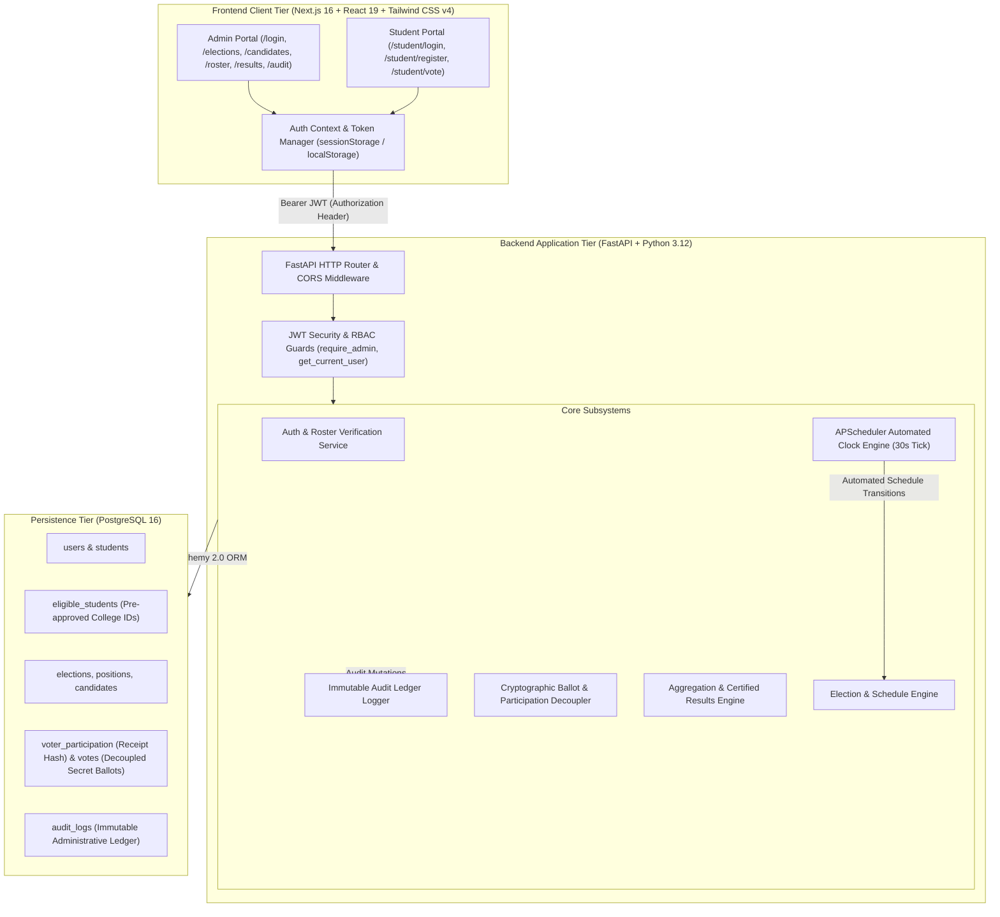
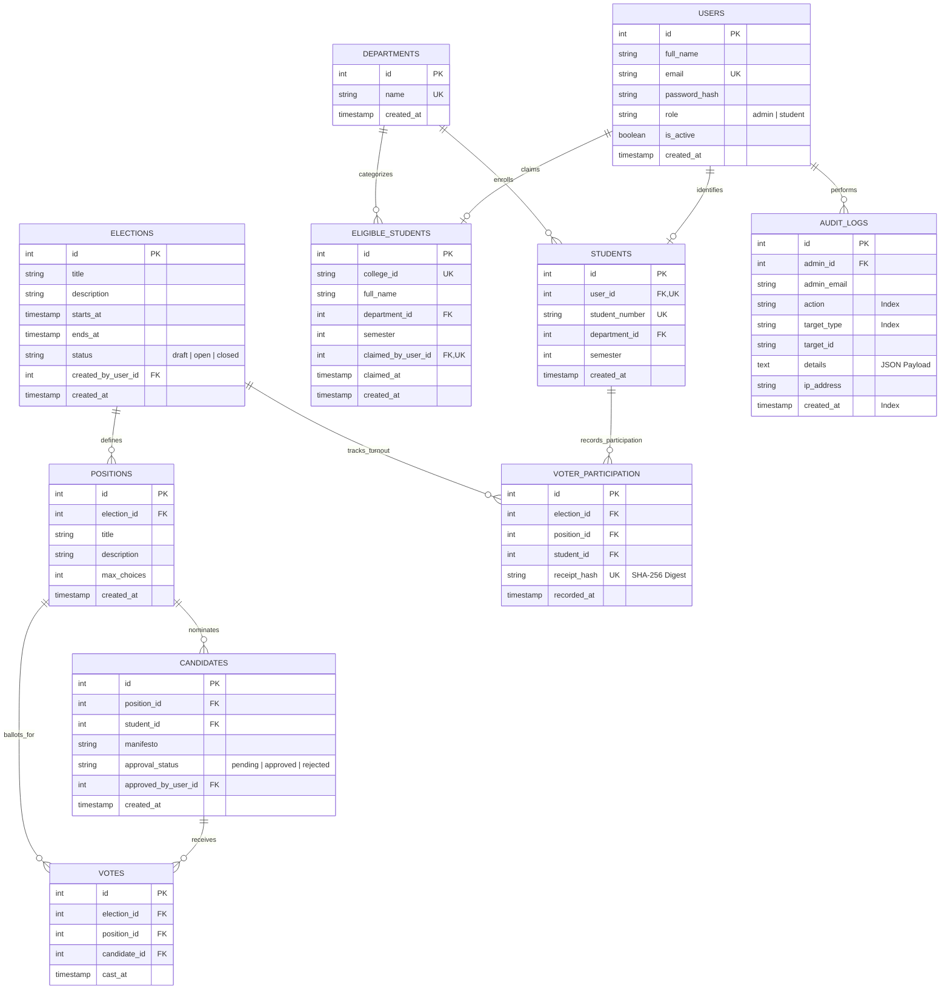
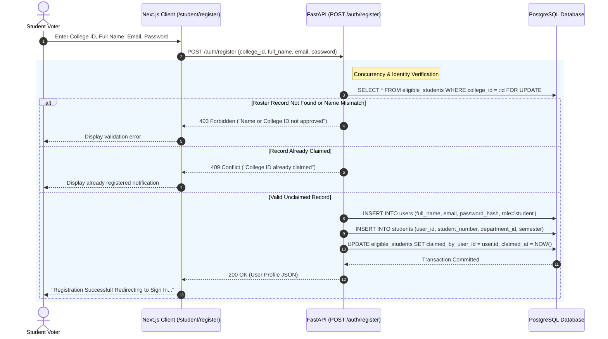
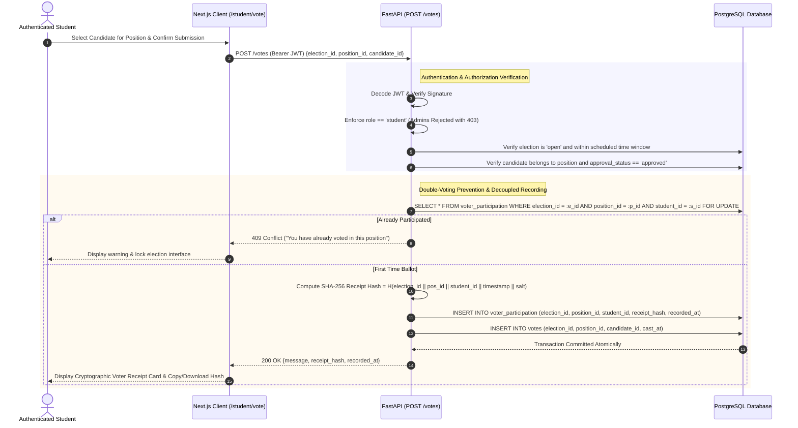
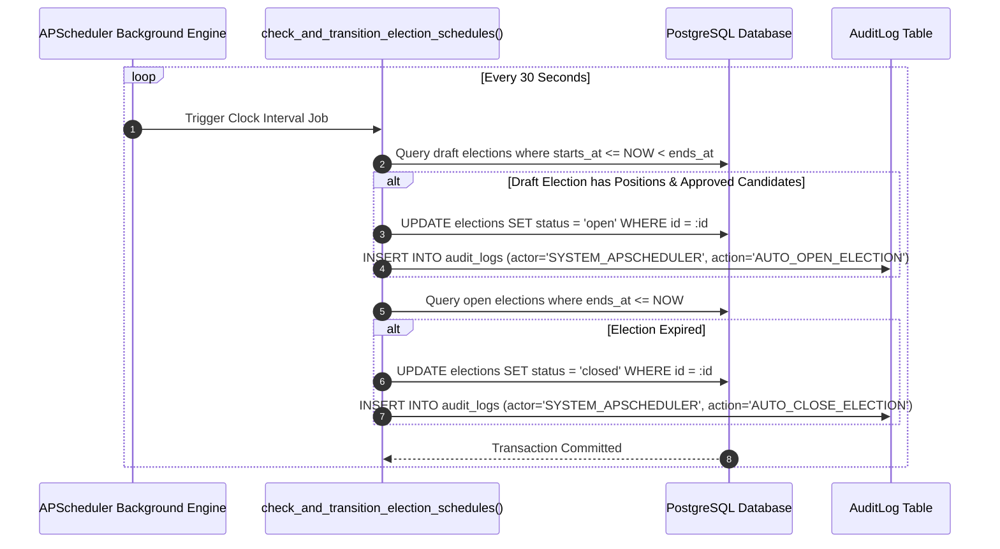
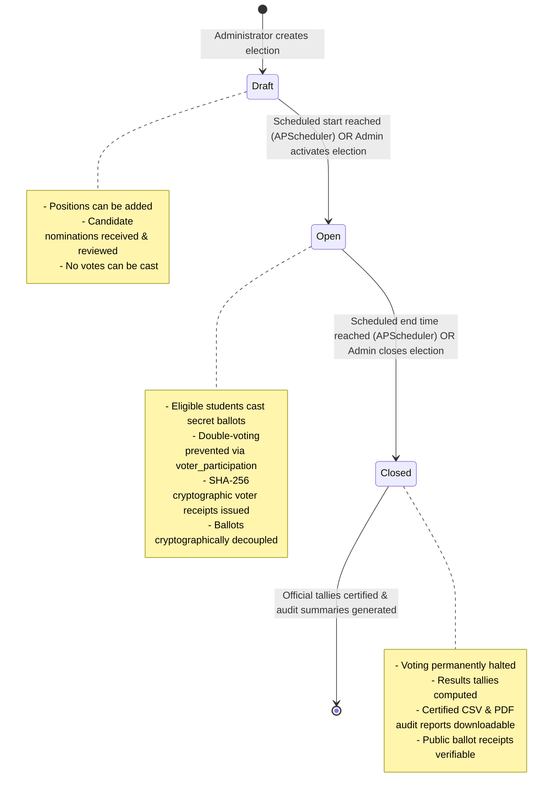

# SmartVote: Architecture & UML Diagrams

This document contains the complete software engineering specification, Entity-Relationship Diagram (ERD), System Architecture, Sequence Diagrams, and State Machines for the SmartVote College Election Management System.

---

## 1. High-Level System Architecture

---

## 2. Entity-Relationship Diagram (ERD)

The database schema guarantees cryptographic anonymity and voter privacy by strictly decoupling voter participation timestamps (`voter_participation`) from candidate ballot marks (`votes`), while recording an append-only audit trail (`audit_logs`) of all administrative mutations.

---

## 3. Sequence Diagram 1: Student Roster Claim & Registration

Demonstrates how unregistered students authenticate against the pre-approved institutional roster using pessimistic locking (`with_for_update`) to prevent duplicate registrations.

---

## 4. Sequence Diagram 2: Secret Ballot Casting & Cryptographic Receipt Generation

Demonstrates the security architecture that guarantees voter anonymity while providing verifiable proof of casting:
1. Participation is recorded under the student's ID (`voter_participation`) with a **SHA-256 cryptographic receipt hash** to prevent double voting.
2. The ballot mark (`votes`) contains **zero** voter identification, foreign keys, or user references.
3. The voter receives the SHA-256 hash receipt for independent verification.

---

## 5. Sequence Diagram 3: Automated Election Clock Lifecycle (APScheduler)

Demonstrates how APScheduler automatically checks election schedules in the background every 30 seconds and transitions statuses into the immutable audit ledger.

---

## 6. State Diagram: Election Lifecycle

